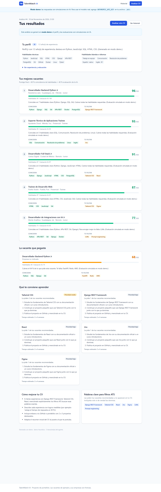
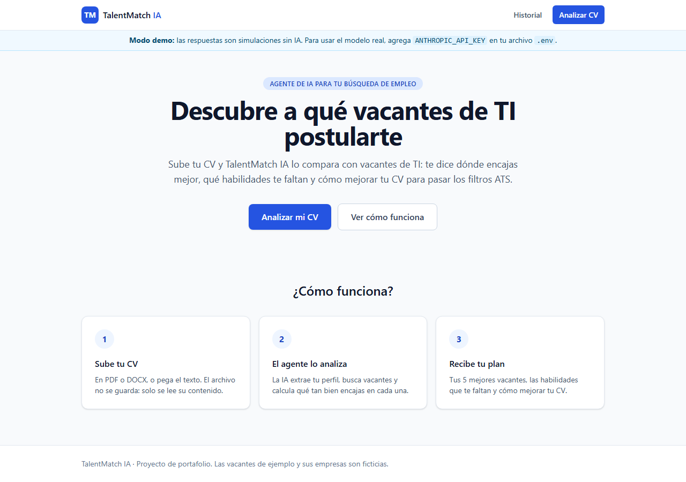
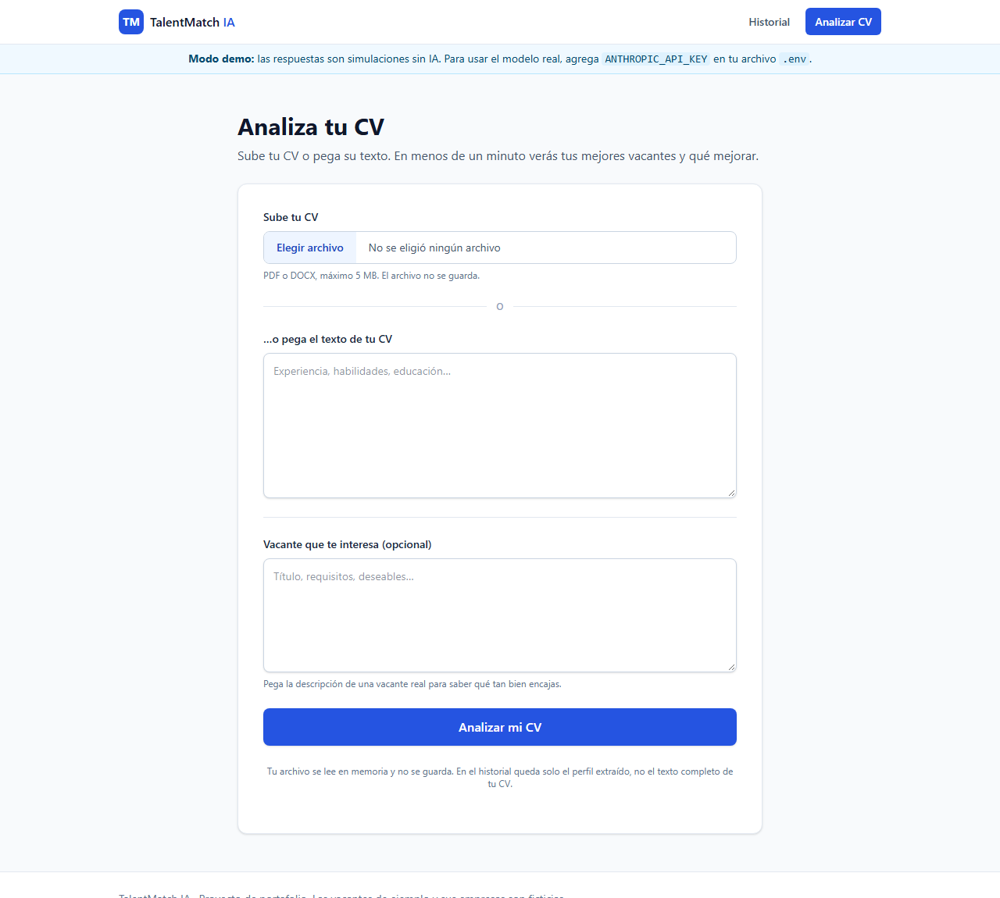
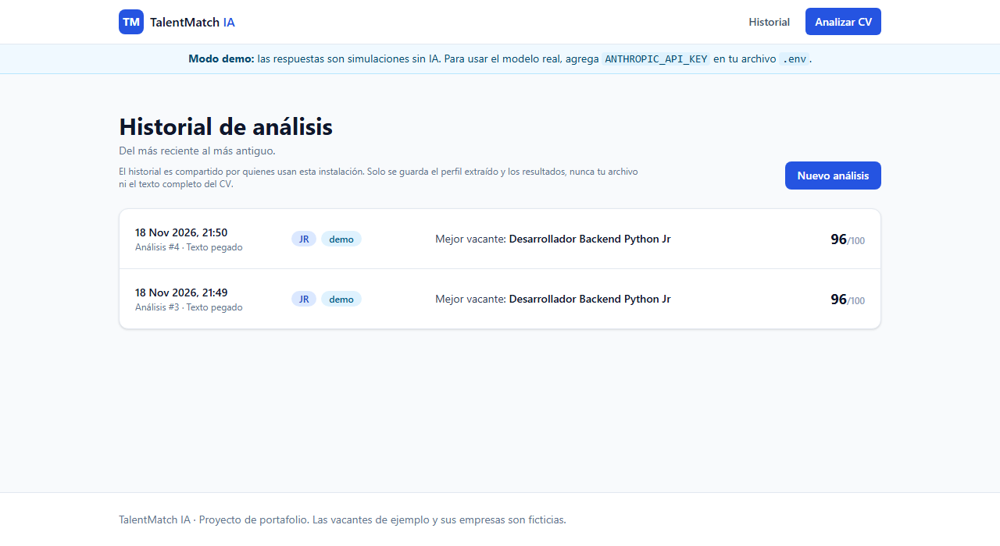
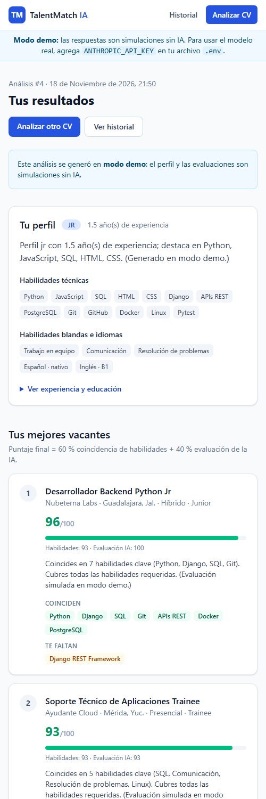
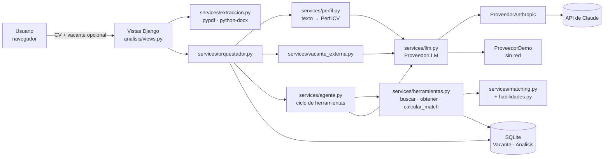
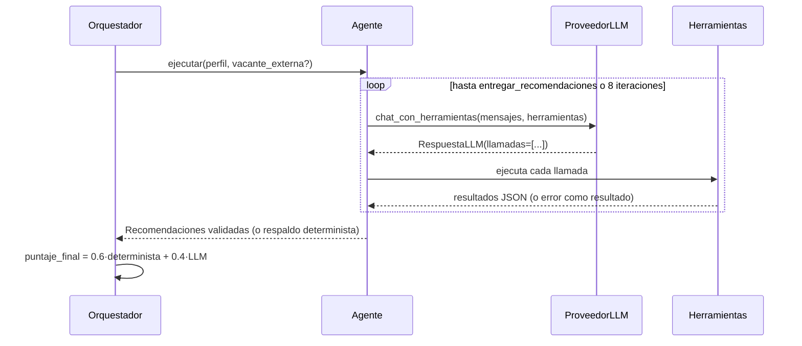

# TalentMatch IA

Agente de IA que analiza tu CV, lo compara con vacantes de TI y te dice **a qué vacantes postularte**,
**qué habilidades te faltan** (con un mini plan para aprenderlas) y **cómo mejorar tu CV** para pasar los filtros ATS.

Hecho con **Python, Django, la API de Claude (Anthropic) y Tailwind CSS**. Se puede correr **gratis y sin API key** en modo demo.




---

## Índice

1. [El problema](#el-problema)
2. [Capturas](#capturas)
3. [Arquitectura](#arquitectura)
4. [Cómo funciona el agente](#cómo-funciona-el-agente)
5. [Cómo ejecutarlo en local](#cómo-ejecutarlo-en-local)
6. [Modo demo](#modo-demo)
7. [Pruebas](#pruebas)
8. [Estructura del proyecto](#estructura-del-proyecto)
9. [Decisiones técnicas](#decisiones-técnicas)
10. [Cómo se construyó](#cómo-se-construyó)
11. [Siguientes pasos](#siguientes-pasos)

📘 ¿Quieres el detalle módulo por módulo? Lee la **[guía técnica](docs/ARQUITECTURA.md)**.

---

## El problema

Quien busca su primer o segundo empleo en TI suele postularse "a ciegas": no sabe en qué vacantes tiene
posibilidades reales, qué le falta para las que le interesan ni por qué su CV no pasa los filtros automáticos (ATS).

TalentMatch IA responde esas tres preguntas en menos de un minuto:

| Pregunta | Qué entrega |
|---|---|
| ¿A qué me postulo? | Top 5 de vacantes con un puntaje de 0 a 100, desglosado y explicado. |
| ¿Qué me falta? | Brechas priorizadas por cuántas de tus mejores vacantes las piden, con 2 a 4 pasos para aprender cada una. |
| ¿Cómo mejoro mi CV? | Sugerencias concretas y las palabras clave ATS que te faltan. |

También puedes **pegar una vacante real** y ver qué tan bien encajas en ella.

> El catálogo incluye 20 vacantes **de ejemplo con empresas inventadas**. Se pueden agregar vacantes reales desde el admin de Django.

## Capturas

| Inicio | Formulario |
|---|---|
|  |  |

| Historial | Resultados en el móvil |
|---|---|
|  |  |

## Arquitectura



**Capas:**

- **`vacantes/` y `analisis/`** (apps de Django): modelos, admin, formularios, vistas y plantillas.
- **`services/`**: toda la lógica, sin depender de las vistas. Ahí están la extracción del CV, el matching, la capa del LLM, el agente y el orquestador.
- **`services/llm.py`**: define una interfaz `ProveedorLLM` y tipos neutrales (`RespuestaLLM`, `LlamadaHerramienta`…). **El resto del código nunca importa el SDK de Anthropic**: solo lo hace [`proveedor_anthropic.py`](services/proveedores/proveedor_anthropic.py).

**Flujo de un análisis:**

1. Se extrae el texto del CV **en memoria**. El archivo nunca se guarda.
2. El LLM convierte el texto en un `PerfilCV`, que se valida con Pydantic.
3. Si el usuario pegó una vacante, el LLM la estructura y se le calcula el mismo puntaje.
4. El **agente** busca vacantes, calcula el match de las más prometedoras y entrega sus recomendaciones.
5. El orquestador calcula el **puntaje final** y guarda todo en una transacción.

## Cómo funciona el agente

El agente es un **ciclo de *tool use* escrito a mano** ([`services/agente.py`](services/agente.py)). En cada vuelta pasa esto:



**Herramientas** ([`services/herramientas.py`](services/herramientas.py)). Todas son de **solo lectura**:

| Herramienta | Qué hace |
|---|---|
| `buscar_vacantes(nivel, modalidad, habilidades, limite)` | Lista vacantes activas, ordenadas por cuántas de esas habilidades piden (máximo 10). |
| `obtener_vacante(vacante_id)` | Devuelve el detalle completo de una vacante. |
| `calcular_match(vacante_id)` | Calcula el puntaje determinista contra el perfil, con las habilidades que coinciden y las que faltan. |
| `entregar_recomendaciones(...)` | Herramienta final con esquema estricto: top 5, brechas, sugerencias y palabras ATS. |

**Por qué es confiable:**

- **El LLM decide qué herramientas llamar y en qué orden; el código decide qué datos cuentan.** El perfil se pasa a las herramientas desde el contexto, así que el modelo no puede alterarlo.
- **El puntaje final lo calcula el código**, no el LLM: `0.6 × determinista + 0.4 × evaluación del LLM`. El peso es configurable. Así el modelo no puede "inflar" la parte objetiva.
- **Hay límites:** máximo 8 iteraciones y 1 corrección si la entrega no cumple el esquema. Si se superan, entra un **respaldo determinista**: el usuario igual recibe un top 5, marcado como "resultado parcial".
- **Los errores de una herramienta vuelven al modelo** (`is_error`) para que corrija su llamada, en lugar de tumbar el análisis.
- **Mitigación de *prompt injection*:** el CV y la vacante van entre etiquetas XML y el *prompt* indica que son datos, no instrucciones. Además, toda la salida se valida con un esquema.

### Matching híbrido

1. **Normalización** ([`services/habilidades.py`](services/habilidades.py)): `"React.js"`, `"ReactJS"` y `"react"` se vuelven `react`, y `"Postgres"` se vuelve `postgresql`. Los símbolos `C#` y `C++` se conservan.
2. **Puntaje determinista** ([`services/matching.py`](services/matching.py)): `100 × (0.8 × requeridas cubiertas + 0.2 × deseables cubiertas)`.
3. **Evaluación del LLM** (0–100): considera la experiencia equivalente, el nivel y el contexto.
4. **Puntaje final** = `0.6 × determinista + 0.4 × LLM`.

## Cómo ejecutarlo en local

Requisitos: **Python 3.10+** (desarrollado con 3.13) y Git. **No necesitas Node** para correrlo.

```bash
git clone https://github.com/JazyelAe/TalentMatch-IA.git
cd TalentMatch-IA
```

Con estos 6 comandos queda corriendo en modo demo:

```bash
python -m venv .venv
.venv\Scripts\activate          # Windows  ·  en macOS/Linux: source .venv/bin/activate
pip install -r requirements.txt
python manage.py migrate
python manage.py cargar_vacantes_ejemplo
python manage.py runserver
```

Abre http://127.0.0.1:8000. Para entrar al admin (`/admin/`) y gestionar vacantes, primero crea un usuario con `python manage.py createsuperuser`.

### Usar la IA real (opcional)

1. Copia `.env.example` como `.env`.
2. Pon tu clave en `ANTHROPIC_API_KEY=` (consíguela en https://console.anthropic.com).
3. Reinicia el servidor. El aviso de "Modo demo" desaparece.

| Variable | Por defecto | Para qué sirve |
|---|---|---|
| `LLM_PROVEEDOR` | `anthropic` | `anthropic` o `demo` (forzar el demo aunque haya key). |
| `LLM_MODELO` | `claude-haiku-5-5` | El modelo más económico; puedes cambiarlo por `claude-sonnet-5-5` u `claude-opus-5-5`. |
| `ANTHROPIC_API_KEY` | vacío | Vacío = modo demo. |
| `AGENTE_MAX_ITERACIONES` | `8` | Límite de vueltas del agente. |
| `MATCH_PESO_DETERMINISTA` | `0.6` | Peso de la parte determinista en el puntaje final. |

> `.env` está en `.gitignore`. Además, el repositorio tiene activada la *push protection* de GitHub, que bloquea cualquier *push* que contenga una API key.

### Cambiar estilos (solo si editas la interfaz)

El CSS compilado (`static/css/app.css`) ya está en el repo. Para modificarlo necesitas Node:

```bash
npm install
npm run css:watch
```

## Modo demo

Si no hay `ANTHROPIC_API_KEY`, la app usa `ProveedorDemo`, que cumple la misma interfaz que el proveedor real **sin red y sin costo**. No devuelve respuestas fijas:

- **Perfil:** detecta en tu CV las habilidades de un catálogo de 75 tecnologías, estima los años de experiencia y deduce el nivel.
- **Agente:** sigue un guion que usa **las mismas herramientas reales** (`buscar_vacantes` → `calcular_match` × N → `entregar_recomendaciones`), así que el ciclo del agente se ejercita igual que con el LLM.
- **Evaluación:** el "puntaje LLM" se simula a partir del puntaje determinista, ajustado por la cercanía de nivel, y se indica que es simulado.

Toda la interfaz muestra un aviso visible mientras el modo demo está activo.

## Pruebas

```bash
pip install -r requirements-dev.txt
pytest
pytest --cov=services --cov=analisis --cov=vacantes
```

- **413 pruebas** con pytest y pytest-django. **98 % de cobertura** (todos los módulos de `services/` están por encima de 97 %).
- **Ninguna prueba puede llamar a la API real.** Un *fixture* global quita la API key y **bloquea los sockets hacia internet** ([`tests/conftest.py`](tests/conftest.py)); si algún código intenta salir, la prueba falla.
- El LLM se simula con `ProveedorFalso` ([`tests/falsos.py`](tests/falsos.py)), que devuelve respuestas programadas, o excepciones para simular un 429 o un *timeout*. El proveedor de Anthropic se prueba con el cliente del SDK simulado.
- Incluye una prueba de punta a punta en modo demo: cargar vacantes → subir un DOCX → ver resultados → historial.

## Estructura del proyecto

```
config/        Configuración de Django (todo lo sensible viene de variables de entorno)
vacantes/      App del catálogo: modelo Vacante, admin y comando de carga de ejemplos
analisis/      App web: formulario, vistas, historial y plantillas
services/      Lógica de negocio: extracción, matching, capa LLM, agente y orquestador
templates/     Plantilla base y páginas de error
static/        Tailwind (fuente en src/, CSS compilado en css/)
tests/         413 pruebas con pytest
docs/          Guía técnica y capturas
```

La explicación de cada archivo está en la [guía técnica](docs/ARQUITECTURA.md#1-mapa-del-código).

## Decisiones técnicas

| Decisión | Por qué |
|---|---|
| **Ciclo del agente escrito a mano** (no el *Tool Runner* del SDK) | Así el agente no depende del proveedor y cada línea se puede explicar. Los proveedores solo traducen formatos. |
| **Capa `ProveedorLLM` con tipos neutrales** | Cambiar de proveedor es escribir una clase nueva. El demo y el falso de pruebas implementan la misma interfaz. |
| **Pydantic para todo lo que devuelve el LLM** | Si el modelo inventa un nivel o un puntaje de 150, se rechaza antes de llegar a la BD. Los esquemas generan el JSON Schema estricto que recibe la API (`strict: true`, salida estructurada). |
| **Herramienta final `entregar_recomendaciones`** | La salida final llega con un esquema garantizado, en vez de texto libre que habría que "adivinar". |
| **Haiku 5.5 por defecto** | Es el más económico (USD 0.10/0.50 por millón de tokens). Como la parte determinista pesa 60 %, el resultado no depende solo del modelo, y subir de modelo es cambiar una variable. |
| **`tool_choice: auto`** | Algunos modelos actuales no aceptan forzar una herramienta, así que el *prompt* guía al modelo y el código verifica la entrega. |
| **Tailwind v4 con el CLI oficial (npm) y el CSS compilado en el repo** | El CDN no es apto para producción. `django-tailwind` agrega complejidad sin beneficio aquí. Como el CSS ya está compilado, quien solo corre el proyecto no necesita Node. |
| **El archivo del CV solo vive en memoria** | `FILE_UPLOAD_HANDLERS` usa solo memoria y una prueba verifica que no quede en disco. En la BD se guarda el perfil, no el texto completo. |
| **SQLite** | Cero configuración para quien clone el repo. |
| **Análisis síncrono** | Es más simple para un MVP. La interfaz muestra un indicador de carga y bloquea el doble envío. |

Las especificaciones completas están en [SPEC.md](SPEC.md) y el plan tarea por tarea en [PLAN.md](PLAN.md).

## Cómo se construyó

El proyecto siguió un **desarrollo guiado por especificaciones**, en cuatro fases con aprobación entre cada una:

1. **Especificación** ([SPEC.md](SPEC.md)): objetivo, alcance del MVP, historias de usuario con criterios de aceptación, modelo de datos, arquitectura y riesgos.
2. **Plan** ([PLAN.md](PLAN.md)): 25 tareas pequeñas, cada una con su criterio de "terminado" y sus pruebas.
3. **Implementación**: una tarea a la vez, con código, pruebas y un commit en formato [Conventional Commits](https://www.conventionalcommits.org/es/).
4. **Documentación**: este README y la guía técnica.

Herramientas: Python 3.13, Django 5.2, Pydantic 2, SDK `anthropic`, pypdf, python-docx, Tailwind CSS 4,
pytest + pytest-django + pytest-cov, Git y GitHub. El desarrollo se hizo en *pair programming* con
**Claude Code** (asistente de programación con IA): la IA propuso e implementó el código bajo la
especificación y el plan aprobados, y cada fase se revisó antes de avanzar.

## Siguientes pasos

- Procesar el análisis en segundo plano (Celery o RQ) y mostrar el progreso del agente en vivo.
- Cuentas de usuario para que cada persona tenga un historial privado.
- Despliegue con Docker, PostgreSQL y WhiteNoise, más CI en GitHub Actions.
- Un conjunto de CVs de evaluación (*evals*) para medir la calidad de las recomendaciones al cambiar de modelo o de *prompt*.
- OCR para PDFs escaneados.
- Ampliar el diccionario de sinónimos de habilidades, o complementarlo con *embeddings*.
