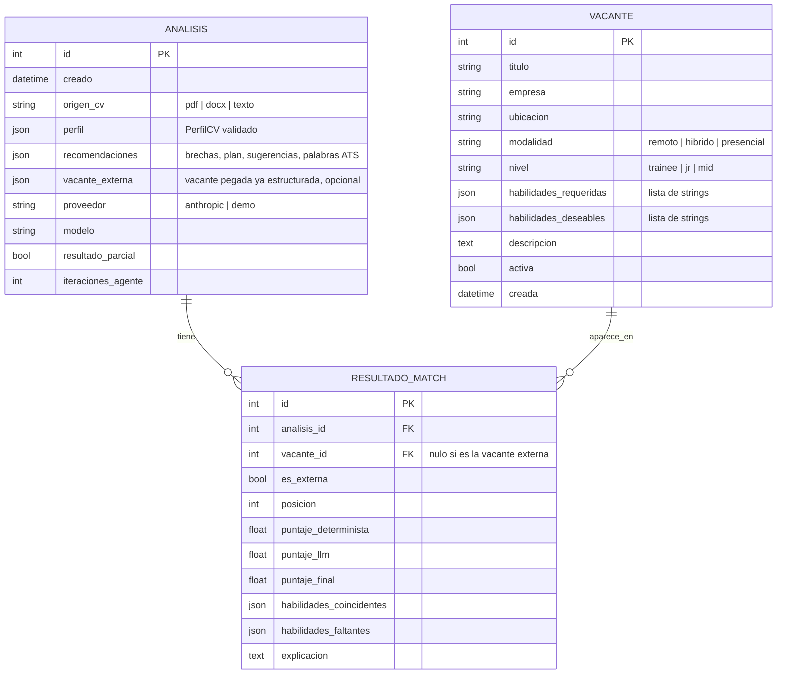
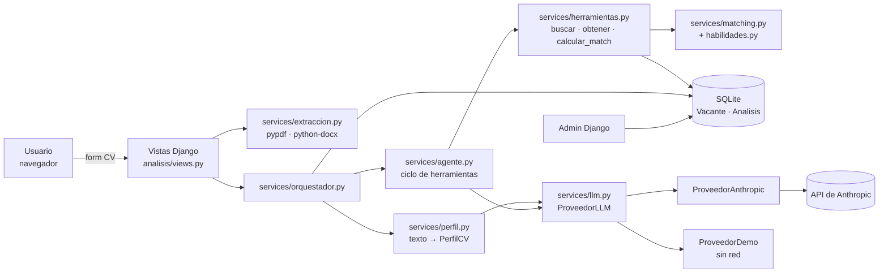
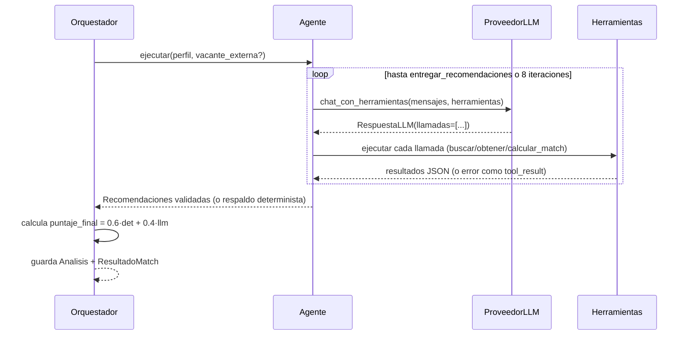

# SPEC — TalentMatch IA (MVP)

> Estado: **APROBADO** (2026-11-18)
> Fecha: 2026-11-18

---

## 1. Objetivo

TalentMatch IA es una aplicación web que analiza el CV de una persona, lo compara con vacantes de TI
y le dice:

1. **A qué vacantes postularse** (top 5, con un puntaje de 0 a 100 y una explicación).
2. **Qué habilidades le faltan**, priorizadas, con un mini plan de aprendizaje.
3. **Cómo mejorar su CV**, incluidas palabras clave para pasar filtros ATS.

El análisis lo hace un **agente de IA con herramientas**: el LLM decide qué vacantes buscar, cuáles
revisar a detalle y contra cuáles calcular el match, en un ciclo con un límite de iteraciones.

Es un proyecto de portafolio. Por eso tiene dos prioridades además de funcionar:
- **Que cualquiera pueda correrlo sin pagar** (modo demo sin API key).
- **Que el código se pueda explicar en una entrevista**: poca magia, capas claras y pruebas.

---

## 2. Alcance del MVP

| # | Funcionalidad | Resumen |
|---|---|---|
| F1 | Entrada del CV | Subir PDF o DOCX, o pegar texto. El archivo se procesa en memoria y **nunca se guarda**. |
| F2 | Perfil estructurado | El LLM convierte el texto del CV en un JSON validado con Pydantic. |
| F3 | Vacantes | Modelo `Vacante`, CRUD en el admin de Django y un comando que carga 20 vacantes ficticias. |
| F3b | Vacante pegada | El usuario puede pegar el texto de una vacante real; se analiza junto con las de la BD sin guardarse en el catálogo. |
| F4 | Matching híbrido | Puntaje = parte determinista (habilidades normalizadas) + evaluación del LLM. |
| F5 | Agente con herramientas | Ciclo propio de *tool use* con `buscar_vacantes`, `obtener_vacante` y `calcular_match`. |
| F6 | Recomendaciones | Top 5, brechas priorizadas con mini plan y sugerencias de CV/ATS. |
| F7 | Historial | Cada análisis se guarda (perfil, resultados y fecha) y se puede consultar. |
| NF | No funcionales | Proveedor de LLM intercambiable, modo demo, secretos en `.env`, pruebas con LLM simulado, errores claros, UI responsiva con Tailwind. |

---

## 3. Fuera de alcance (MVP)

- Cuentas de usuario, login o un historial por persona (el historial es **global**, ver riesgo R6).
- Scraping o integración con bolsas de trabajo reales (LinkedIn, OCC, Indeed, etc.).
- OCR de PDFs escaneados (si un PDF no tiene texto, se le pide al usuario que pegue el texto).
- Generar o reescribir el CV completo (solo se dan sugerencias).
- Procesamiento en segundo plano (Celery/colas): el análisis es síncrono (ver riesgo R3).
- Despliegue a producción, Docker y CI (pueden ser "siguientes pasos" en el README).
- Otros proveedores de LLM además de Anthropic y demo: la interfaz los permite, pero no se implementan.
- Borrar o editar análisis desde la interfaz (solo desde el admin).
- Idiomas de interfaz distintos al español.

---

## 4. Decisiones técnicas

### 4.1 Stack

| Capa | Elección | Por qué |
|---|---|---|
| Backend | **Python 3.13 + Django 5.2 LTS** | Requisito del proyecto. 5.2 es LTS (soporte hasta 2028). |
| Base de datos | **SQLite** | Cero configuración para quien clone el repo. Los JSON se guardan en `JSONField`. |
| Validación | **Pydantic v2** | Valida lo que devuelve el LLM (perfil, evaluación y recomendaciones). |
| Lectura de CV | **pypdf** y **python-docx** | Requisito. Son puras de Python y ligeras. |
| LLM | **SDK oficial `anthropic`** detrás de una interfaz propia | Ver 4.3. |
| Config | **python-dotenv** | Lee `.env` en `settings.py`. Es mínima y fácil de explicar. |
| Pruebas | **pytest + pytest-django** | Requisito. El LLM siempre va simulado. |
| Estilos | **Tailwind CSS v4 (CLI oficial vía npm)** | Ver 4.2. |

### 4.2 Integración de Tailwind (justificación)

| Opción | ¿Producción? | Problema |
|---|---|---|
| CDN (`<script src=…tailwindcss>`) | ❌ | La propia documentación de Tailwind dice que no es para producción: compila en el navegador en cada carga. |
| `django-tailwind` | ✅ | Agrega una app de Django y además necesita Node. Es más complejo sin ganar nada aquí. |
| `pytailwindcss` | ✅ | Descarga un binario la primera vez que corre. Es menos transparente. |
| **CLI oficial (`@tailwindcss/cli`) como devDependency de npm** | ✅ | **Elegida.** |

**Cómo funciona:** `static/src/input.css` → `npx @tailwindcss/cli -i … -o static/css/app.css --minify`.
El **CSS compilado se sube al repo**, así que quien solo quiera *correr* el proyecto (un reclutador)
**no necesita Node**. Solo se necesita Node para *cambiar estilos*. Ya tienes Node 24 instalado.

### 4.3 Capa de proveedor de LLM (`services/llm.py`)

```python
class ProveedorLLM(ABC):
    def generar_estructurado(self, sistema: str, mensaje: str, esquema: type[BaseModel]) -> BaseModel: ...
    def chat_con_herramientas(self, sistema: str, mensajes: list[dict], herramientas: list[Herramienta]) -> RespuestaLLM: ...
```

- `RespuestaLLM` es **nuestro** formato neutral (`texto`, `llamadas: list[LlamadaHerramienta]`,
  `razon_fin`). Cada proveedor traduce de y hacia su formato. El agente nunca importa `anthropic`.
- Implementaciones: `ProveedorAnthropic` y `ProveedorDemo`.
- `obtener_proveedor()` decide según las variables de entorno:
  - `LLM_PROVEEDOR=anthropic|demo` (por defecto `anthropic`).
  - `LLM_MODELO` (por defecto `claude-haiku-5-5`, el más económico; se puede subir a `claude-sonnet-5-5` o `claude-opus-5-5`).
  - `ANTHROPIC_API_KEY`: **si falta, se usa el modo demo automáticamente** y la interfaz lo muestra con un aviso.
- **Ciclo de agente escrito a mano** (no el *Tool Runner* del SDK). Tiene dos razones: (1) así el ciclo
  no depende de ningún proveedor, y (2) en una entrevista puedes explicar cada línea.
- Detalles del modelo que respetamos: `tool_choice` siempre en `auto` (varios modelos actuales, como
  Opus 5.5 y Sonnet 5.5, no aceptan forzar una herramienta, así que funciona con cualquiera) y
  herramientas con `strict: true`. Además se revisa `stop_reason` antes de
  leer la respuesta, incluido `refusal`.

### 4.4 Modo demo (`ProveedorDemo`)

No devuelve un JSON fijo: **sí usa el CV real**, pero sin IA.
- **Perfil:** busca en el texto las habilidades de un catálogo (`services/catalogo_habilidades.py`) y
  estima el nivel con reglas simples (años mencionados y palabras como "trainee" o "senior").
- **Agente:** sigue una secuencia guionizada que usa las mismas herramientas reales
  (`buscar_vacantes` → `calcular_match` × N → `entregar_recomendaciones`). Así el ciclo y las
  herramientas se ejercitan igual que con el LLM.
- **Evaluación LLM:** se simula a partir del puntaje determinista y queda marcada como "simulada".

### 4.5 Matching híbrido

1. **Normalización** (`services/habilidades.py`): minúsculas, sin acentos ni puntuación y un
   diccionario de sinónimos (`js`→`javascript`, `postgres`→`postgresql`, `react.js`→`react`,
   `drf`→`django rest framework`, …).
2. **Puntaje determinista (0–100):**
   `100 × (0.8 × requeridas_cubiertas / total_requeridas + 0.2 × deseables_cubiertas / total_deseables)`.
   Si una vacante no tiene deseables, ese 20 % pasa a las requeridas.
3. **Puntaje LLM (0–100):** el agente lo da para cada vacante candidata, con una explicación breve.
   Considera lo que la parte determinista no ve: experiencia equivalente, nivel y contexto.
4. **Puntaje final** = `PESO_DETERMINISTA × det + (1 − PESO_DETERMINISTA) × llm`, con
   `MATCH_PESO_DETERMINISTA=0.6` por defecto. **El cálculo final lo hace el código, no el LLM**, para
   que el modelo no pueda "inflar" la parte determinista.

### 4.6 Flujo del agente

1. Se extrae el texto del CV (código, sin LLM).
2. Se genera el perfil con una llamada estructurada (`generar_estructurado` + `PerfilCV`).
3. Ciclo del agente (máx. `AGENTE_MAX_ITERACIONES=8`):
   - El LLM recibe el perfil y las herramientas, y decide qué llamar.
   - El código ejecuta las herramientas y devuelve los resultados.
   - El ciclo termina cuando el LLM llama a la herramienta final `entregar_recomendaciones`
     (con esquema estricto y validada otra vez con Pydantic).
4. Si se alcanza el límite de iteraciones, o el LLM entrega JSON inválido dos veces, hay un **respaldo
   determinista**: top 5 por puntaje determinista, sin plan de aprendizaje y con el aviso
   "resultado parcial".

> `entregar_recomendaciones` es una cuarta herramienta, además de las tres mínimas. Sirve para que la
> salida final llegue con un esquema garantizado en vez de texto libre que habría que "adivinar".

---

## 5. Historias de usuario y criterios de aceptación

### HU-01 — Subir mi CV
*Como* persona que busca empleo en TI, *quiero* subir mi CV en PDF o DOCX, o pegar su texto, *para*
no tener que reescribirlo.
- [ ] El formulario acepta `.pdf` y `.docx` de hasta 5 MB, o texto pegado (uno de los dos es obligatorio).
- [ ] Si el archivo tiene otra extensión, está corrupto o pesa más de 5 MB, se muestra un mensaje claro en español y no se rompe nada.
- [ ] Si el texto extraído tiene menos de 200 caracteres, se muestra el error "CV vacío o ilegible", con la sugerencia de pegar el texto.
- [ ] Si el texto supera 30 000 caracteres, se rechaza con un mensaje (nunca se recorta en silencio).
- [ ] El archivo se lee en memoria y **no queda guardado en disco ni en la BD** (lo verifica una prueba).

### HU-02 — Ver mi perfil estructurado
*Como* usuario, *quiero* ver qué entendió el sistema de mi CV, *para* confiar en el análisis.
- [ ] El perfil muestra habilidades técnicas, habilidades blandas, experiencia, educación, idiomas y nivel (`trainee`/`jr`/`mid`).
- [ ] El perfil se valida con Pydantic. Si el LLM devuelve un JSON inválido, se reintenta una vez y después se muestra un error claro.

### HU-03 — Recibir mis mejores vacantes
*Como* usuario, *quiero* ver las 5 vacantes que mejor encajan conmigo, *para* saber a cuáles postularme.
- [ ] Se muestran hasta 5 vacantes ordenadas por puntaje final.
- [ ] Cada una muestra el puntaje final y su desglose (determinista y LLM), las habilidades que coinciden, las que faltan y una explicación de 1 a 3 frases.
- [ ] El puntaje determinista de una vacante es siempre el mismo para el mismo perfil (lo verifica una prueba).

### HU-04 — Analizar una vacante que encontré
*Como* usuario, *quiero* pegar el texto de una vacante real, *para* saber si encajo en ella.
- [ ] Hay un campo opcional "Pegar vacante" en el formulario.
- [ ] El LLM la convierte en una vacante estructurada. Se evalúa con el mismo puntaje híbrido y aparece en una sección aparte de los resultados.
- [ ] No se agrega al catálogo de vacantes (`Vacante`).

### HU-05 — Saber qué me falta aprender
*Como* usuario, *quiero* ver mis brechas de habilidades priorizadas con un mini plan, *para* saber qué estudiar primero.
- [ ] Se listan de 3 a 7 brechas, ordenadas por prioridad (según cuántas vacantes del top las piden).
- [ ] Cada brecha tiene un mini plan: 2 a 4 pasos concretos y un tiempo estimado.

### HU-06 — Mejorar mi CV
*Como* usuario, *quiero* sugerencias concretas para mi CV, *para* pasar filtros ATS y llamar la atención.
- [ ] Se muestran de 3 a 6 sugerencias accionables.
- [ ] Se muestra una lista de palabras clave ATS que faltan en el CV y que aparecen en las vacantes del top.

### HU-07 — Consultar análisis anteriores
*Como* usuario, *quiero* ver mis análisis pasados, *para* comparar mi avance.
- [ ] `/historial/` lista los análisis (fecha, nivel, mejor vacante y su puntaje), del más reciente al más antiguo y paginados.
- [ ] Cada uno abre su página de resultados, que muestra exactamente lo que se guardó.

### HU-08 — Probarlo sin API key (reclutador)
*Como* reclutador que revisa el portafolio, *quiero* correr el proyecto sin pagar nada, *para* ver cómo funciona.
- [ ] Sin `ANTHROPIC_API_KEY`, la app arranca en modo demo y lo indica con un aviso visible.
- [ ] El flujo completo (subir CV → resultados → historial) funciona en modo demo.
- [ ] Los pasos para correrlo en local caben en ≤ 6 comandos del README.

### HU-09 — Administrar vacantes (admin)
*Como* administrador, *quiero* gestionar vacantes desde el admin de Django, *para* mantener el catálogo.
- [ ] Hay CRUD completo de `Vacante` en `/admin/`, con filtros por nivel y modalidad y búsqueda por título y empresa.
- [ ] `python manage.py cargar_vacantes_ejemplo` carga 20 vacantes de empresas inventadas y se puede correr varias veces sin duplicar (es idempotente).
- [ ] Cada vacante de ejemplo dice "(ficticia)" en su descripción.

### HU-10 — Errores claros
*Como* usuario, *quiero* entender qué falló, *para* saber qué hacer.
- [ ] Una API key inválida, el límite de la API (429), un fallo de conexión o de servidor (5xx), una negativa del modelo o un JSON mal formado producen cada uno un mensaje distinto en español, sin traza técnica.
- [ ] Los errores se registran en el log con detalle técnico, sin datos del CV.

---

## 6. Modelo de datos



- `RESULTADO_MATCH.vacante` usa `on_delete=SET_NULL` y además guarda una copia del título y la empresa,
  para que el historial no se rompa si se borra una vacante.
- **No se guarda el texto completo del CV**, solo el perfil estructurado (minimización de datos). Ver la pregunta abierta P2.

**Esquemas Pydantic** (`services/esquemas.py`): `PerfilCV`, `Experiencia`, `Educacion`, `Idioma`,
`VacanteEstructurada` (para la vacante pegada), `EvaluacionVacante`, `Brecha`, `PasoAprendizaje` y
`Recomendaciones`.

---

## 7. Arquitectura

### 7.1 Componentes



### 7.2 Ciclo del agente



### 7.3 Estructura de carpetas (propuesta)

```
TalentMatch-IA/
├── config/                 # settings, urls, wsgi
├── vacantes/               # app: modelo Vacante, admin, comando cargar_vacantes_ejemplo
├── analisis/               # app: modelos Analisis/ResultadoMatch, formularios, vistas, plantillas
├── services/               # lógica pura, sin vistas: llm, extraccion, perfil, agente, herramientas, matching
├── templates/              # base.html y parciales
├── static/src/input.css    # fuente de Tailwind
├── static/css/app.css      # CSS compilado (se sube al repo)
├── tests/                  # pytest
├── .env.example
├── requirements.txt
├── package.json            # solo para el CLI de Tailwind
├── SPEC.md · PLAN.md · README.md
```

### 7.4 Páginas

| Ruta | Página |
|---|---|
| `/` | Inicio: qué hace, cómo funciona y botón "Analizar mi CV". |
| `/analizar/` | Formulario: archivo o texto del CV + vacante pegada opcional. Muestra un indicador de carga mientras procesa. |
| `/analisis/<id>/` | Resultados: perfil, top 5, vacante externa, brechas con plan y sugerencias de CV. |
| `/historial/` | Lista paginada de análisis. |
| `/admin/` | Admin de Django (vacantes y análisis). |

---

## 8. Variables de entorno (`.env.example`)

```
DJANGO_SECRET_KEY=cambia-esto
DJANGO_DEBUG=True
LLM_PROVEEDOR=anthropic          # anthropic | demo
LLM_MODELO=claude-haiku-5-5
ANTHROPIC_API_KEY=               # vacío = modo demo
AGENTE_MAX_ITERACIONES=8
MATCH_PESO_DETERMINISTA=0.6
```

---

## 9. Estrategia de pruebas

- **Nunca se llama a la API real.** Las pruebas usan un `ProveedorFalso` con respuestas programadas, y
  una *fixture* de pytest bloquea la red (`ANTHROPIC_API_KEY` vacía y `socket` bloqueado).
- **Unitarias:** extracción (PDF/DOCX generados en la prueba), normalización, puntaje determinista,
  herramientas, validación Pydantic y traducción de `ProveedorAnthropic` (con el cliente del SDK simulado).
- **Del agente:** ciclo normal, herramienta inexistente, argumentos inválidos, límite de iteraciones,
  JSON inválido → reintento → respaldo.
- **Integración (Django test client):** flujo completo en modo demo, historial, errores del formulario
  y que el archivo no quede guardado.
- **Meta:** ≥ 80 % de cobertura en `services/`.

---

## 10. Riesgos

| # | Riesgo | Impacto | Mitigación |
|---|---|---|---|
| R1 | El LLM devuelve JSON inválido o incompleto | Análisis roto | Herramienta final con `strict: true` + validación Pydantic + 1 reintento + respaldo determinista. |
| R2 | El agente entra en bucle o gasta muchos tokens | Costo y latencia | Límite de 8 iteraciones; `buscar_vacantes` devuelve máximo 10 resultados resumidos. |
| R3 | El análisis tarda 30–90 s (petición síncrona) | Mala experiencia o *timeout* | Indicador de carga; el *timeout* del SDK queda configurado. Las colas son un siguiente paso. |
| R4 | Costo de la API | Gasto inesperado | Haiku 5.5 por defecto (USD 0.10/0.50 por millón de tokens); el modelo se cambia por env y el modo demo es gratuito. |
| R4b | Haiku razona peor que Opus en casos ambiguos | Evaluaciones menos finas | La parte determinista pesa 60 %; subir de modelo es cambiar una variable de entorno. |
| R5 | Fuga de la API key en un repo público | Alto | `.gitignore`, `.env.example`, *push protection* de GitHub (ya activa) y la key nunca se muestra en logs. |
| R6 | Historial global sin login: cualquiera con acceso ve los análisis | Privacidad | Solo se guarda el perfil (no el CV), se avisa en la interfaz y el uso es local. El login queda fuera de alcance. |
| R7 | PDFs escaneados o con columnas extraen mal el texto | Perfil pobre | Mínimo de 200 caracteres + sugerencia de pegar el texto. |
| R8 | La normalización de habilidades falla con sinónimos nuevos | Puntaje injusto | Diccionario ampliable + la parte LLM compensa; ambas partes se muestran desglosadas. |
| R9 | *Prompt injection* dentro del CV o de la vacante pegada | El LLM ignora instrucciones | El texto va delimitado como dato; las herramientas solo leen; la salida se valida con un esquema. |
| R10 | El modelo rechaza la petición (`stop_reason: refusal`) | Análisis sin resultado | Se detecta y se muestra un mensaje claro (Haiku no tiene *fallback* en el servidor). |

---

## 11. Dependencias a instalar (requieren tu aprobación)

**Python:** `django>=5.2,<6`, `anthropic`, `pydantic>=2`, `pypdf`, `python-docx`, `python-dotenv`,
`pytest`, `pytest-django`, `pytest-cov`.
**Node (solo desarrollo):** `tailwindcss`, `@tailwindcss/cli`.

---

## 12. Decisiones tomadas en la revisión

- **P1 — Vacante pegada:** se analiza **junto** con las del catálogo y se muestra en una sección aparte (HU-04).
- **P2 — Texto del CV:** **no se guarda** el texto extraído, solo el perfil estructurado.
- **P3 — Modelo por defecto:** `claude-haiku-5-5`, configurable con `LLM_MODELO`.
- **P4 — Herramienta final:** se aprueba `entregar_recomendaciones` (sección 4.6).
- **Dependencias** de la sección 11: aprobadas.
