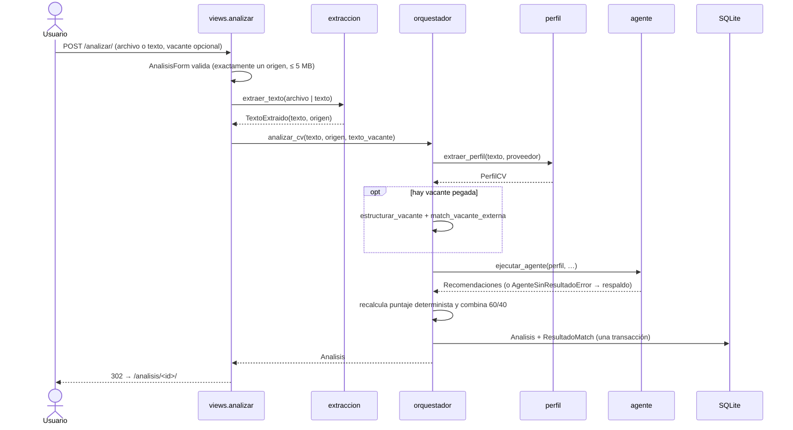
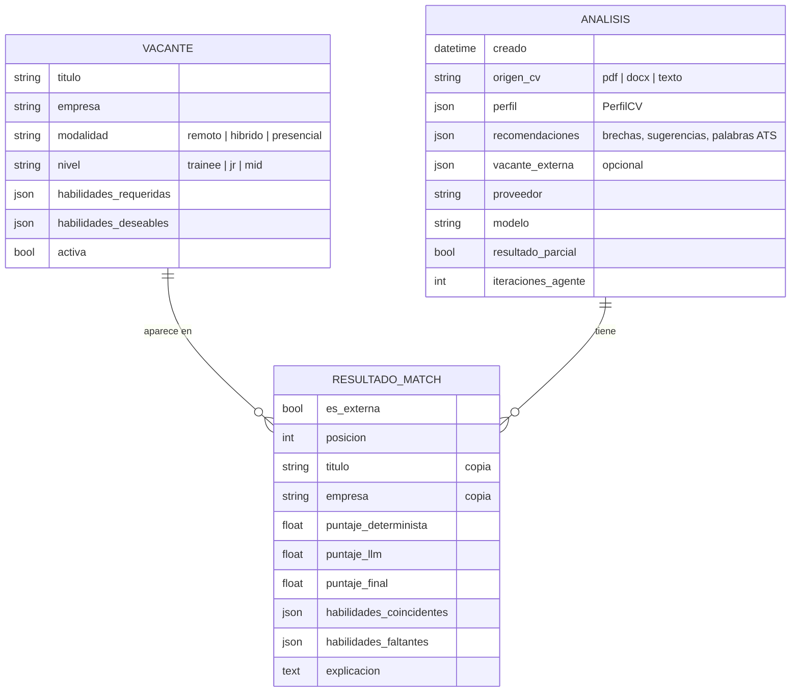
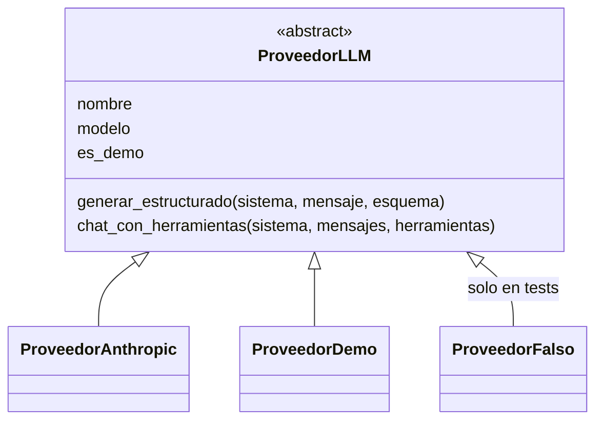

# Guía técnica de TalentMatch IA

Este documento explica **cómo está construido** el proyecto por dentro: qué hace cada módulo, cómo viaja
una petición de principio a fin, cómo se manejan los errores y por qué se tomó cada decisión.
Para instalarlo y usarlo, empieza por el [README](../README.md).

---

## 1. Mapa del código

```
TalentMatch-IA/
├── config/                     Proyecto Django
│   ├── settings.py             Configuración; todo lo sensible viene de variables de entorno
│   ├── entorno.py              Helpers para leer variables con tipo (bool, int, float)
│   └── urls.py
├── vacantes/                   App: catálogo de vacantes
│   ├── models.py               Modelo Vacante + validador de listas de habilidades
│   ├── admin.py                CRUD con filtros y búsqueda
│   ├── data/vacantes_ejemplo.json            20 vacantes ficticias
│   └── management/commands/cargar_vacantes_ejemplo.py
├── analisis/                   App: análisis de CV (web)
│   ├── models.py               Analisis y ResultadoMatch (historial)
│   ├── forms.py                AnalisisForm (archivo O texto + vacante opcional)
│   ├── views.py                inicio, analizar, resultado, historial
│   ├── context_processors.py   Variable `modo_demo` para todas las plantillas
│   └── templates/analisis/     Páginas (Tailwind)
├── services/                   Lógica de negocio, independiente de las vistas
│   ├── extraccion.py           PDF / DOCX / texto → texto limpio
│   ├── habilidades.py          Normalización de nombres de habilidades
│   ├── matching.py             Puntaje determinista y combinación de puntajes
│   ├── esquemas.py             Esquemas Pydantic de todo lo que produce el LLM
│   ├── prompts.py              Delimitar texto del usuario (anti prompt injection)
│   ├── llm.py                  Interfaz ProveedorLLM, tipos neutrales, errores, fábrica
│   ├── proveedores/
│   │   ├── proveedor_anthropic.py   Único archivo que usa el SDK de Anthropic
│   │   └── proveedor_demo.py        Proveedor sin IA para el modo demo
│   ├── catalogo_habilidades.py Catálogo para detectar habilidades sin IA (demo)
│   ├── perfil.py               CV → PerfilCV
│   ├── vacante_externa.py      Vacante pegada → VacanteEstructurada
│   ├── herramientas.py         Herramientas del agente + despachador
│   ├── agente.py               Ciclo de tool use
│   ├── respaldo.py             Recomendaciones deterministas (plan B y demo)
│   └── orquestador.py          Une todo y guarda en la BD
├── templates/                  base.html, 404.html, 500.html
├── static/src/input.css        Fuente de Tailwind  →  static/css/app.css (compilado)
├── tests/                      24 archivos de prueba (pytest)
├── SPEC.md · PLAN.md           Especificación y plan de implementación
└── docs/                       Esta guía y las capturas
```

**Regla de dependencias:** `vistas → services → modelos`. Las vistas no contienen lógica de negocio y
`services/` no conoce las peticiones HTTP. Solo `orquestador.py` escribe en la base de datos.

---

## 2. Recorrido de una petición

Qué pasa desde que el usuario pulsa **"Analizar mi CV"** hasta que ve sus resultados:



1. **Formulario** ([analisis/forms.py](../analisis/forms.py)): exige archivo **o** texto (no ambos) y rechaza archivos de más de 5 MB.
2. **Extracción** ([services/extraccion.py](../services/extraccion.py)): lee el archivo en memoria con pypdf o python-docx (incluidas las tablas), limpia espacios y valida que el texto tenga entre 200 y 30 000 caracteres.
3. **Perfil** ([services/perfil.py](../services/perfil.py)): una llamada estructurada al LLM devuelve un `PerfilCV` validado. Si el JSON no cumple el esquema, se reintenta una vez.
4. **Vacante pegada** ([services/vacante_externa.py](../services/vacante_externa.py)): se estructura igual que el perfil y se le calcula el mismo puntaje determinista. Nunca entra al catálogo.
5. **Agente** ([services/agente.py](../services/agente.py)): ver la sección 4.
6. **Guardado** ([services/orquestador.py](../services/orquestador.py)): el código **recalcula** el puntaje determinista de cada vacante (no confía en el LLM), lo combina con la evaluación del LLM, ordena por puntaje final y guarda todo dentro de `transaction.atomic()`.

---

## 3. Modelo de datos



- `(titulo, empresa)` es único en `Vacante`, lo que hace idempotente al comando de carga.
- `ResultadoMatch.vacante` usa `SET_NULL` y guarda una copia del título y la empresa, para que el historial siga funcionando aunque se borre la vacante.
- **No se guarda ni el archivo ni el texto completo del CV**, solo el perfil estructurado.

---

## 4. El agente por dentro

### 4.1 Tipos neutrales

[services/llm.py](../services/llm.py) define el "idioma" común entre el agente y cualquier proveedor:

| Tipo | Representa |
|---|---|
| `Herramienta(nombre, descripcion, esquema)` | Una herramienta disponible para el modelo |
| `LlamadaHerramienta(id, nombre, argumentos)` | Una llamada que pidió el modelo |
| `RespuestaLLM(texto, llamadas, razon_fin, contenido_original)` | Un turno del modelo |
| `ResultadoHerramienta(llamada_id, contenido, es_error)` | La respuesta de nuestra herramienta |
| `MensajeUsuario` / `MensajeAsistente` / `MensajeResultados` | El historial de la conversación |

`contenido_original` guarda la respuesta tal como la dio el proveedor, para **reenviarla sin cambios** en el
siguiente turno: algunos modelos exigen recibir de vuelta sus bloques internos.

### 4.2 El ciclo

```python
for iteracion in range(1, max_iteraciones + 1):
    respuesta = proveedor.chat_con_herramientas(SISTEMA_AGENTE, mensajes, HERRAMIENTAS_AGENTE)
    mensajes.append(MensajeAsistente(respuesta))
    # sin llamadas → se le recuerda una vez que debe entregar
    # por cada llamada: si es entregar_recomendaciones → validar; si no → ejecutar_herramienta
    # entrega válida → return; dos entregas inválidas → AgenteSinResultadoError
    mensajes.append(MensajeResultados(resultados))
raise AgenteSinResultadoError("límite de iteraciones")
```

Una ejecución típica tarda 3 vueltas: `buscar_vacantes` → varios `calcular_match` en paralelo → `entregar_recomendaciones`.

### 4.3 Garantías

| Riesgo | Cómo se controla |
|---|---|
| Bucle infinito o gasto excesivo | Máximo `AGENTE_MAX_ITERACIONES` (8) y búsquedas de máximo 10 resultados |
| Argumentos inválidos | Cada herramienta valida sus argumentos con un modelo Pydantic; el error vuelve al LLM con `is_error` |
| Entrega mal formada | Herramienta final con `strict: true` + validación Pydantic + 1 corrección |
| Ids inventados | `validar_entrega` comprueba que cada `vacante_id` exista y esté activo |
| Puntajes inflados | El puntaje determinista lo recalcula el orquestador |
| El modelo no termina | Respaldo determinista y aviso de "resultado parcial" |
| Prompt injection | Texto del usuario entre etiquetas XML, herramientas de solo lectura, salida validada |

---

## 5. Capa de proveedores



- **`obtener_proveedor()`** elige el proveedor según `LLM_PROVEEDOR` y `ANTHROPIC_API_KEY`. Sin key, usa el demo.
- **`ProveedorAnthropic`**:
  - Usa `messages.create` con `output_config.format` (JSON Schema) para la salida estructurada, y herramientas con `strict: true` y `tool_choice: auto`.
  - Revisa `stop_reason`: `refusal` lanza `RechazoModeloError`; con `max_tokens` se descartan las llamadas posiblemente incompletas.
  - Traduce las excepciones del SDK, de la más específica a la más general: 401/403 → `ApiKeyInvalidaError`, 429 → `LimiteApiError`, 5xx o red → `ConexionLLMError`, 404 → modelo inexistente.
  - El SDK ya reintenta por su cuenta los 429, los 5xx y los errores de red (2 reintentos), y el tiempo de espera es de 120 s.
- **`ProveedorDemo`**: detecta habilidades con expresiones regulares sobre un catálogo y estima el nivel por años de experiencia. Como no guarda estado, deduce en qué paso del guion va contando los turnos que ya dio.

**Para agregar otro proveedor** (por ejemplo, OpenAI): crea `services/proveedores/proveedor_x.py` con una clase que herede de `ProveedorLLM`, regístrala en `obtener_proveedor()` y agrega su valor a `PROVEEDORES_VALIDOS`. No se toca nada más.

---

## 6. Manejo de errores

| Origen | Excepción | Lo que ve el usuario |
|---|---|---|
| Formulario | `ValidationError` | Error junto al campo (sin archivo ni texto, ambos a la vez, > 5 MB) |
| Extracción | `ArchivoInvalidoError`, `CVVacioError`, `CVDemasiadoLargoError` | Mensaje con qué hacer (por ejemplo, "pega el texto") |
| Vacante pegada | `VacanteExternaInvalidaError` | Error en el campo de la vacante |
| LLM | Subclases de `ErrorLLM` | `mensaje_usuario` específico de cada error; el detalle técnico va solo al log |
| Catálogo | `CatalogoVacioError` | Indica correr `cargar_vacantes_ejemplo` |
| Inesperado | Cualquiera | Página 500 propia |

Los logs registran solo metadatos (tipo de error, iteración, herramientas pedidas), **nunca el texto del CV**.
Hay pruebas que verifican esto.

---

## 7. Seguridad y privacidad

- Secretos solo en `.env` (ignorado por git) y *push protection* de GitHub activada en el repositorio.
- `SECRET_KEY` obligatoria cuando `DEBUG=False`: si falta, la app no arranca.
- Subidas solo en memoria (`MemoryFileUploadHandler`); el CV nunca toca el disco.
- El *prompt* pide omitir datos personales. En modo demo, la primera línea del CV (normalmente el nombre), los correos y los teléfonos se descartan.
- Herramientas del agente de solo lectura.
- CSRF de Django en el formulario y escape automático de las plantillas.

---

## 8. Estrategia de pruebas

| Capa | Archivos | Técnica |
|---|---|---|
| Lógica pura | `test_habilidades`, `test_matching`, `test_esquemas`, `test_extraccion` | Casos parametrizados; PDF y DOCX generados en memoria |
| Proveedores | `test_proveedor_anthropic`, `test_proveedor_demo`, `test_llm` | Cliente del SDK simulado con `MagicMock` |
| Agente | `test_herramientas`, `test_agente`, `test_respaldo_y_demo` | `ProveedorFalso` con respuestas programadas |
| Orquestación | `test_orquestador`, `test_analisis_modelos` | BD de pruebas, transacciones |
| Web | `test_vista_*`, `test_avisos_y_errores`, `test_e2e_demo` | Cliente de pruebas de Django |

`tests/conftest.py` aplica en **todas** las pruebas un bloqueo de red a nivel de `socket` y quita la API key.
Por eso ninguna prueba puede llamar a la API real, aunque el código lo intentara.

---

## 9. Configuración (variables de entorno)

| Variable | Defecto | Descripción |
|---|---|---|
| `DJANGO_SECRET_KEY` | clave de desarrollo si `DEBUG=True` | Obligatoria en producción |
| `DJANGO_DEBUG` | `True` | |
| `DJANGO_ALLOWED_HOSTS` | `localhost,127.0.0.1` | Separados por coma |
| `LLM_PROVEEDOR` | `anthropic` | `anthropic` o `demo` |
| `LLM_MODELO` | `claude-haiku-5-5` | Cualquier modelo de Claude |
| `ANTHROPIC_API_KEY` | vacío | Vacío = modo demo |
| `AGENTE_MAX_ITERACIONES` | `8` | |
| `MATCH_PESO_DETERMINISTA` | `0.6` | Entre 0 y 1 |
